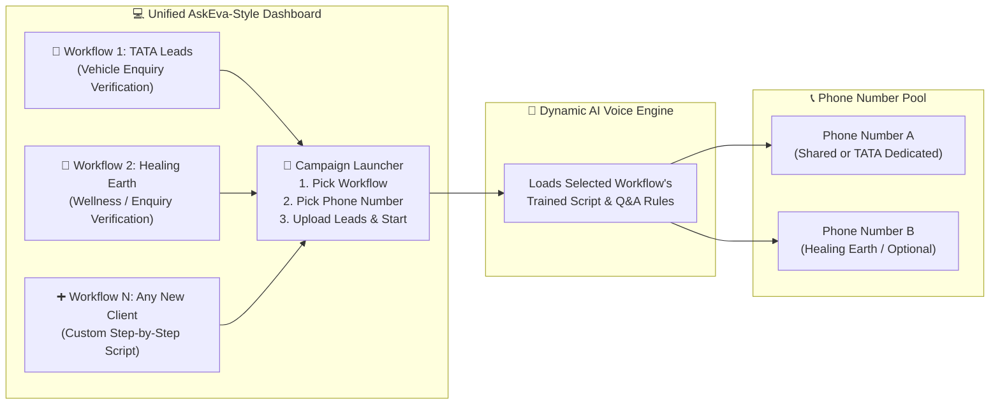

# AskEva-Style Multi-Workflow Outbound AI Voice Platform (Master Plan)

> **Finalized Requirement (From Sir):**  
> - **Platform Style:** **AskEva-Style Unified Dashboard** supporting multiple clients/workflows (e.g., **TATA Leads**, **Healing Earth**, and any future client).  
> - **Call Direction:** **Outbound Calls Only** (Single Number Dial + Bulk CSV/Excel Campaign Dialer). **No Incoming Calls.**  
> - **Phone Number Flexibility:** Can use **one shared phone number** across all workflows OR **assign different phone numbers** per workflow/client.  
> - **Workflow-Based Training:** Each workflow has its own step-by-step script, questions, YES/NO keyword triggers, and AI rules configured directly from the Dashboard.  
> - **Team Split (15 Working Days):**  
>   - **Module 1 (Ramkumar — Backend):** Multi-Workflow Engine, Number Router, Single & Bulk Outbound Queue, CRM Database & Excel Export.  
>   - **Module 2 (Kousic — Frontend):** AskEva-Style Sidebar Dashboard, Workflow Builder/Trainer UI, Single/Bulk Dialer with Workflow & Number Selector, Client-wise Reports.  
>   - **Module 3 (Ramkumar + Kousic — Joint AI Voice & Brain):** Dynamic Workflow Prompt/Script Loader, Tamil & English Neural TTS/STT, Intent/YES-NO Classifier & Live Call Simulator.

---

## 1. How the AskEva-Style Multi-Workflow System Works

---

## 2. Built-in Default Workflows (Ready Out-of-the-Box)

1. **Workflow 1: TATA Motors — Vehicle Enquiry Verification**
   - **Step 1 (Greeting):** *"வணக்கம் `{name}` சார்! நான் TATA-ல இருந்து பேசுறேன். நீங்க `{item}` வண்டி பத்தி என்கொயரி பண்ணிருந்தீங்க இல்லையா?"*
   - **Step 2 (Q1 - Staff Contact):** *"எங்க TATA ஸ்டாஃப் உங்ககிட்ட போன் பண்ணி பேசுனாங்களா சார்?"* (`YES` / `NO`)
   - **Step 3 (Q2 - Satisfaction):** *"அவங்க சொன்ன விவரம் எல்லாம் புரிஞ்சுதா, நீங்க Satisfied-ஆ சார்?"* (`YES` / `NO` + Remark)

2. **Workflow 2: Healing Earth — Customer Enquiry & Service Follow-Up**
   - **Step 1 (Greeting):** *"வணக்கம் `{name}`! நான் Healing Earth-ல இருந்து பேசுறேன். நீங்க எங்க `{item}` சர்வீஸ் / புராடக்ட் பத்தி என்கொயரி பண்ணிருந்தீங்க இல்லையா?"*
   - **Step 2 (Q1 - Staff Contact):** *"எங்க Healing Earth டீம் உங்ககிட்ட பேசி டீடெயில்ஸ் சொன்னாங்களா?"* (`YES` / `NO`)
   - **Step 3 (Q2 - Satisfaction):** *"உங்களுக்கு எல்லா விவரமும் தெளிவா புரிஞ்சுதா, நீங்க Satisfied-ஆ?"* (`YES` / `NO` + Remark)

3. **+ Unlimited Custom Workflows:**
   - Create any new client workflow in 1 minute from the Dashboard (**Workflow Name**, **Step 1 Greeting**, **Step 2 Question**, **Step 3 Question**, **YES/NO Replies**, and **Default Caller Number**).
